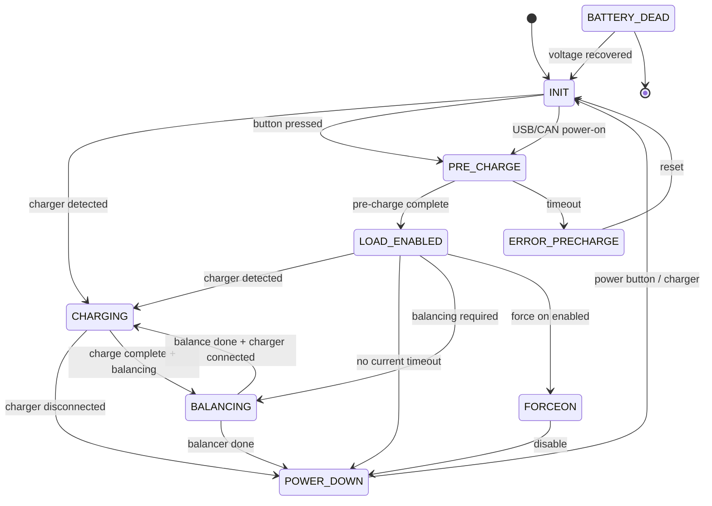

# State Machine

The operational state machine (`modOperationalState`) manages all BMS operational modes. It ensures safe transitions between states and enforces safety checks.

## State Overview

| State | Description |
|-------|-------------|
| `OP_STATE_INIT` | Initialization, waits for button press or charger |
| `OP_STATE_CHARGING` | Charging mode, manages charge current |
| `OP_STATE_PRE_CHARGE` | Pre-charge sequence to protect load |
| `OP_STATE_LOAD_ENABLED` | Normal operation, battery powering load |
| `OP_STATE_FORCEON` | Forced on state (bypass protection) |
| `OP_STATE_BALANCING` | Cell balancing mode |
| `OP_STATE_POWER_DOWN` | Safe shutdown sequence |
| `OP_STATE_BATTERY_DEAD` | Battery too low to operate |
| `OP_STATE_ERROR_PRECHARGE` | Pre-charge failure |

## State Diagram



## State Details

### OP_STATE_INIT

The initialization state is the default state after power-on or reset.

**Entry Actions:**
- Initialize display in splash screen mode
- Enable FET driver
- Reset various timers

**Behavior:**
- Check for charger connection
- Check for power button press
- Wait for splash screen timeout

**Transitions:**
- → `OP_STATE_CHARGING` if charger detected
- → `OP_STATE_PRE_CHARGE` if button pressed or external power-on
- → `OP_STATE_BATTERY_DEAD` if discharge not allowed and no charger

### OP_STATE_CHARGING

Charging mode when external charger is connected.

**Entry Actions:**
- Enable charge FET
- Start charging LED pattern (flash)

**Behavior:**
- Monitor charge current
- Check for charger disconnect
- Evaluate if balancing is needed

**Transitions:**
- → `OP_STATE_POWER_DOWN` if charger disconnected
- → `OP_STATE_BALANCING` if charge complete and balancing needed

### OP_STATE_PRE_CHARGE

Pre-charge sequence to safely ramp up load capacitance.

**Entry Actions:**
- Reset pre-charge timeout
- Disable discharge and charge FETs

**Behavior:**
- Enable pre-charge FET
- Monitor load voltage vs pack voltage
- Check pre-charge completion (>75% of pack voltage)

**Transitions:**
- → `OP_STATE_LOAD_ENABLED` if pre-charge successful
- → `OP_STATE_FORCEON` if force on enabled
- → `OP_STATE_ERROR_PRECHARGE` if timeout (default 5s)

### OP_STATE_LOAD_ENABLED

Normal operation mode - battery powering load.

**Entry Actions:**
- Enable discharge FET
- Optionally enable charge FET (if allowed during discharge)

**Behavior:**
- Monitor pack current
- Check for charger connection
- Monitor cell balancing requirements
- Track "not used" timeout

**Transitions:**
- → `OP_STATE_INIT` if charger detected (if charging during discharge not allowed)
- → `OP_STATE_PRE_CHARGE` if battery voltage too low
- → `OP_STATE_POWER_DOWN` if no current for timeout period
- → `OP_STATE_BALANCING` if charge balance active and conditions met

### OP_STATE_FORCEON

Forced on state - bypasses some safety protections.

**Behavior:**
- Similar to LOAD_ENABLED but ignores certain checks
- Used for diagnostic or emergency situations

**Transitions:**
- → `OP_STATE_POWER_DOWN` if force on disabled

### OP_STATE_BALANCING

Cell balancing mode when cells need voltage equalization.

**Entry Actions:**
- Enable cell balancing resistors

**Behavior:**
- Monitor cell voltage mismatch
- Continue until mismatch below threshold

**Transitions:**
- → `OP_STATE_CHARGING` if charger connected
- → `OP_STATE_POWER_DOWN` if balancing complete

### OP_STATE_POWER_DOWN

Safe shutdown sequence.

**Entry Actions:**
- Disable all FETs

**Behavior:**
- Wait for button press or charger to restart

**Transitions:**
- → `OP_STATE_INIT` on button press or charger connect

### OP_STATE_BATTERY_DEAD

Battery voltage too low to operate.

**Entry Actions:**
- Show battery dead display

**Behavior:**
- Wait for charger to recover battery

**Transitions:**
- → `OP_STATE_INIT` when voltage recovers

### OP_STATE_ERROR_PRECHARGE

Pre-charge failure - load didn't reach target voltage in time.

**Entry Actions:**
- Disable all FETs
- Show error display

**Behavior:**
- Latch error state until reset

**Transitions:**
- → `OP_STATE_INIT` on reset

## Timeout Values

| Timeout | Default | Description |
|---------|---------|-------------|
| Splash screen | 2s | Display splash time |
| Pre-charge | 5s | Maximum pre-charge time |
| Not used | Configurable | Idle timeout before power down |
| Charging complete | Configurable | Time to wait after full charge |

## Configuration

State machine behavior can be configured via `modConfigGeneralConfigStructTypedef`:

- `displayTimeoutSplashScreen` — Splash screen duration
- `timeoutLCPreCharge` — Pre-charge timeout
- `minimalPrechargePercentage` — Minimum voltage % for pre-charge complete
- `notUsedTimeout` — Idle timeout
- `notUsedCurrentThreshold` — Current threshold for "in use" detection
- `allowChargingDuringDischarge` — Allow charging while load connected

## Module Interface

```c
// Initialization
void modOperationalStateInit(
    modPowerElectricsPackStateTypedef *packState,
    modConfigGeneralConfigStructTypedef *generalConfigPointer,
    modStateOfChargeStructTypeDef *generalStateOfCharge
);

// Main task (call in main loop)
void modOperationalStateTask(void);

// State control
void modOperationalStateSetNewState(OperationalStateTypedef newState);
void modOperationalStateSetAllStates(OperationalStateTypedef newState);

// Utility
void modOperationalStateTerminateOperation(void);
bool modOperationalStateDelayedDisable(bool delayedPowerDownDesired);
```

## Error Handling

The state machine responds to errors from `modPowerElectronics`:

- **Hard faults** — Immediate transition to safe state (POWER_DOWN)
- **Soft faults** — Throttling or warning, may transition to error state
- **Pre-charge failure** — Specific error state with detailed handling

See [Safety Checks](safety-checks.md) for details on error detection.